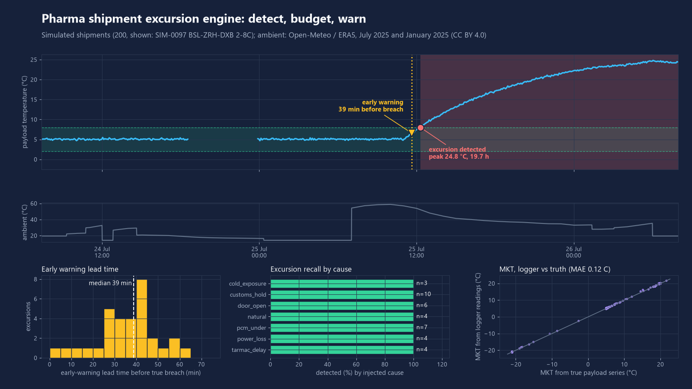
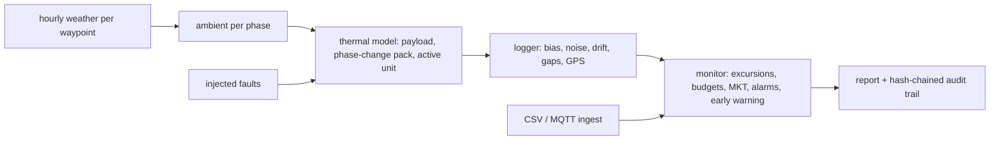

# cold-chain-excursion-engine

Open-source engine for pharma cold-chain monitoring: it finds temperature excursions in logger data, accounts for the stability budget, computes mean kinetic temperature, warns before a breach, and writes a GDP-style shipment report with a hash-chained audit trail.



Simulated data. The engine ran on 200 simulated shipments (311 shipment-days) over real hourly weather for real routes (Basel to Frankfurt to Singapore and four others).

## What it does

- **Simulator.** Shipments over real route waypoints (Basel, Frankfurt, Zurich, Amsterdam, Singapore, Dubai, New York, Tokyo, Sao Paulo). Hourly air temperature and solar radiation come from an open weather archive (see Data sources). A lumped thermal model (insulation, phase-change pack, optional active cooling) turns tarmac, flight, truck and dock phases into a payload temperature. Injected faults: tarmac delay, customs hold, door opening, cold exposure, pack under-conditioned, power loss. Logger effects: sensor bias, noise, 0.1 C resolution, clock drift, data gaps, stuck sensor, isolated spikes, GPS fixes that drop out in flight.
- **Engine.** One causal monitor serves batch and live use. Excursion detection per product profile (2-8 C, 15-25 C, frozen) with debounce and gap handling, cumulative time-out-of-range per band and an additive stability budget, MKT (Arrhenius, dH = 83.144 kJ/mol default, so dH/R = 10000 K), alarm rules (excursion, long excursion, rate of change, budget, data gap, early warning) and a pre-excursion early warning that predicts a breach N minutes ahead from a robust trend (Theil-Sen) or a first-order thermal relaxation model.
- **Compliance-style outputs.** Shipment report (HTML and markdown, optional PDF through the `pdf` extra) with excursions located by nearest GPS fix, band budgets, alarms, data-integrity findings tagged with ALCOA+ attributes, and a SHA-256 hash-chained audit trail that detects edits, deletions and re-ordering. The concepts (attributable, contemporaneous, audit trail, review signature fields) are described generically. This project makes no claim of regulatory compliance and is not validated.
- **Ingest.** CSV logger exports (metadata preamble, `,` `;` tab delimiters, decimal commas, ISO or day-first dates, Fahrenheit, time zones; unparseable rows are returned with line numbers, never dropped silently) and MQTT JSON messages (single object or batch, ISO or epoch timestamps, device from payload or topic).

## Results

Simulated, seed 2026, 200 shipments. Truth = simulated payload temperature (noise-free) out of range for at least 10 consecutive minutes. A detected event matches a true one if they overlap within 15 min. All numbers are from `python -m ccee demo` and are stored in [`results/metrics.json`](results/metrics.json).

| Measure | Result |
|---|---|
| True excursions / shipments containing one | 38 / 38 |
| Event recall | 1.00 (38 of 38) |
| Event precision | 0.98 (51 of 52 detected events overlap a true one) |
| Detected events per true excursion | 1.34 (noise near a limit and data gaps split some excursions) |
| Shipment-level recall / precision | 1.00 / 1.00 |
| Start-time error, median absolute | 6.0 min with clock correction, 6.5 min without |
| Early warning (45 min horizon, thermal model): excursions warned | 84 % (32 of 38) |
| Early warning: median lead time (IQR) | 38.8 min (29.0 to 42.0) |
| Early warning: warning precision / false alarms | 87 % / 1.6 per 100 shipment-days |
| Early warning, linear trend instead: warned / median lead / false alarms | 82 % / 38.9 min / 2.3 per 100 shipment-days |
| MKT, float vs 40-digit decimal reference | max abs error 5e-14 C |
| MKT from logger readings vs MKT of the true payload series | MAE 0.12 C, p95 0.29 C, max 1.03 C |

Early-warning horizon (same fleet): 15 min gives median lead 8.4 min (47 % warned); 30 min gives 22.8 min (68 %); 60 min gives 49.6 min (79 %) with more false alarms (3.5 per 100 shipment-days).

Logger sampling interval (100 shipments each, early-warning window scaled to 6 samples):

| Interval | True excursions | Recall | Precision | Warned | Median lead |
|---|---|---|---|---|---|
| 5 min (main run) | 38 | 1.00 | 0.98 | 84 % | 38.8 min |
| 15 min | 21 | 1.00 | 0.96 | 43 % | 32.1 min |
| 30 min | 27 | 0.96 | 1.00 | 11 % | 9.9 min |

Read these with care: the injected faults are physically large, so recall is saturated at 5 min sampling. The thermal-model predictor is not better than the linear trend on this fleet. Both are limited by the phase-change plateau, where the payload is flat until the pack is exhausted and only then starts to rise.

## Quick start

```bash
python -m venv .venv && . .venv/bin/activate   # Windows: .venv\Scripts\activate
pip install -e ".[dev]"            # add ,mqtt for the live subscriber, ,pdf for PDF output
python -m ccee demo                # about 2-4 min: simulate, score, write results/ and docs/
python -m ccee analyze logger.csv --profile 2-8C --out out/report
python -m ccee mkt --temps 20 30 20 30
python -m ccee verify-audit out/report/logger.audit.jsonl
python -m ccee mqtt --broker localhost --topic "ccee/+/telemetry" --profile 2-8C
pytest -q -p no:asyncio && ruff check .
```

`analyze` exits with 1 when an excursion is found. Sample report: [`docs/sample-report/`](docs/sample-report/). The weather CSVs are cached in `data/weather/`, so the demo runs offline; `python -m ccee fetch-weather` refreshes them.

## How it works



- Excursion convention: from the first out-of-range reading to the first reading back in range; two consecutive out-of-range readings open one. Silence longer than 30 min is a data gap: gap time is not counted as observed, and an excursion that ends during a gap is closed conservatively at the first reading after it.
- Budget: each band outside the label range has an illustrative allowance in minutes; fractions add up as one shared allowance. The built-in allowances are placeholders, not product stability data; configure your own `ProductProfile`.
- Early warning: a robust slope over the last 30 min of readings. Thermal method: ambient implied by `T + tau * dT/dt`, predicted `T(t+h) = Ta + (T - Ta) exp(-h/tau)`. A warning needs two consecutive predicted breaches and a minimum rate of 0.5 C/h, and re-arms after 30 min back in range.
- Lead time is measured against the true (noise-free) breach start. A warning counts as false if no true breach, of any length, follows within horizon + 30 min.

## Data sources

- Hourly 2 m air temperature and shortwave radiation: Open-Meteo historical weather API (https://open-meteo.com), licence CC BY 4.0, based on the ERA5 reanalysis (Copernicus Climate Change Service / ECMWF). Windows: 1-31 July 2025 and 1-31 January 2025, nine airport coordinates. Cached in `data/weather/`.
- Everything else (containers, loggers, faults, shipments) is simulated. Assumed ambient inside a phase: warehouse about 20 C, aircraft hold about 15 C, tarmac = air + 0.015 C per W/m2 of radiation, dock = 70 % air + 30 % 21 C, truck = 60 % outdoor + 40 % 20 C. These are modelling assumptions, not measurements.

## What is not verified yet

- No real logger file or real shipment has been analysed; CSV parsing is tested on hand-written samples only.
- The MQTT subscriber is tested through its message handler, not against a live broker.
- PDF output (optional `weasyprint`) is untested; HTML and markdown are what the tests cover.
- The thermal model is a lumped model with parameters chosen by the author, not fitted to measured containers. Absolute lead times depend on those parameters and on how large the injected faults are.
- Perfect recall at 5 min sampling reflects large simulated excursions, not field performance. Short or marginal real excursions will behave differently.
- Budgets, thresholds and the 10-minute truth definition are illustrative. Nothing here is validated for regulated use and nothing here claims compliance with any regulation or guideline.
- Clock-drift correction assumes offsets were read at start and download; without them drift is only flagged.

## Licence

MIT, Copyright (c) 2026 Victor Bonilla. See [LICENSE](LICENSE).
